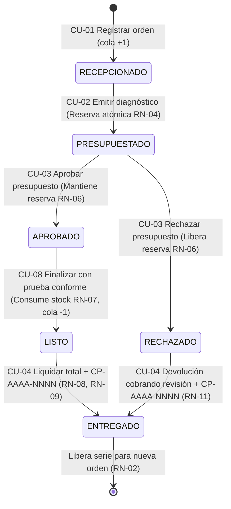

# Data Model: Flujo integral del taller (Iteraciones C2, C3 y C4)

Deriva directamente del Modelo de Dominio Refinado (`docs/aup/caso.md` §3.4 y §4.2.1). Todas las cantidades monetarias usan el tipo personalizado `Dinero` (`Decimal` serializado con 2 decimales exactos).

## 1. Entidades Incorporadas y Ampliadas

### `repuesto` (`Repuesto`) — `CU-07`, `CU-02`, `RN-04`
| Columna | Tipo | Restricciones | Trazabilidad |
|---------|------|---------------|--------------|
| `id` | `INTEGER` | PK | Identificador interno |
| `sku` | `VARCHAR` | `NOT NULL`, `UNIQUE` | Código de catálogo (`GUI-03`) |
| `nombre` | `VARCHAR` | `NOT NULL` | Descripción del componente |
| `stock_disponible` | `INTEGER` | `NOT NULL`, `CHECK >= 0` | Unidades físicas aún no consumidas (`caso.md` §3.6.1) |
| `stock_reservado` | `INTEGER` | `NOT NULL`, `CHECK >= 0`, `CHECK <= stock_disponible` | Unidades comprometidas en presupuestos activos (`RN-04`) |
| `precio_unitario` | `Dinero` | `NOT NULL` | Precio vigente de almacén |
| *`stock_libre`* | *Propiedad* | `stock_disponible - stock_reservado` | Unidades disponibles para nuevas reservas (`RN-04`) |

### `diagnostico` (`Diagnostico`) — `CU-02`, `RF-03`
| Columna | Tipo | Restricciones | Trazabilidad |
|---------|------|---------------|--------------|
| `id` | `INTEGER` | PK | Identificador interno |
| `orden_id` | `INTEGER` | `FK orden_servicio.id`, `UNIQUE`, `NOT NULL` | Relación 1:1 con la orden diagnosticada |
| `informe_tecnico` | `TEXT` | `NOT NULL` | Evaluación técnica de laboratorio (`GUI-03`) |
| `costo_mano_obra` | `Dinero` | `NOT NULL` | Importe de mano de obra |
| `subtotal_repuestos` | `Dinero` | `NOT NULL` | Suma de subtotales de `detalle_repuesto` |
| `total_presupuesto` | `Dinero` | `NOT NULL` | `costo_mano_obra + subtotal_repuestos` |
| `fecha_emision` | `VARCHAR` | `NOT NULL` (ISO-8601 UTC) | Marca temporal de emisión |

### `detalle_repuesto` (`DetalleRepuesto`) — `CU-02`, `RN-04`, `RN-06`, `RN-07`
| Columna | Tipo | Restricciones | Trazabilidad |
|---------|------|---------------|--------------|
| `id` | `INTEGER` | PK | Identificador interno |
| `diagnostico_id` | `INTEGER` | `FK diagnostico.id`, `NOT NULL` | Diagnóstico contenedor |
| `repuesto_id` | `INTEGER` | `FK repuesto.id`, `NOT NULL` | Repuesto reservado |
| `cantidad` | `INTEGER` | `NOT NULL`, `CHECK > 0` | Unidades requeridas |
| `precio_cotizado` | `Dinero` | `NOT NULL` | Precio congelado al emitir presupuesto (`caso.md` §4.2.1) |
| `subtotal` | `Dinero` | `NOT NULL` | `precio_cotizado * cantidad` |
| `estado_reserva` | `VARCHAR` | `CHECK IN ('RESERVADO','LIBERADO','CONSUMIDO')` | Ciclo de vida de la reserva |

### `comprobante_pago` (`ComprobantePago`) — `CU-04`, `RN-08`, `RN-09`
| Columna | Tipo | Restricciones | Trazabilidad |
|---------|------|---------------|--------------|
| `id` | `INTEGER` | PK | Identificador interno |
| `numero` | `VARCHAR` | `UNIQUE`, `NOT NULL` | Formato `CP-AAAA-NNNN` (`CU-04`) |
| `orden_id` | `INTEGER` | `FK orden_servicio.id`, `UNIQUE`, `NOT NULL` | Un único cobro por orden (`RN-08`) |
| `metodo_pago` | `VARCHAR` | `CHECK IN ('EFECTIVO','TARJETA','TRANSFERENCIA')` | Medio de pago (`GUI-06`) |
| `monto_total` | `Dinero` | `NOT NULL` | Total cobrado (`total_presupuesto` o `costo_revision` en `RN-11`) |
| `fecha_emision` | `VARCHAR` | `NOT NULL` (ISO-8601 UTC) | Marca temporal de liquidación |
| `conformidad_entrega` | `BOOLEAN` | `NOT NULL` (`True`) | Conformidad de entrega de equipo y accesorios (`RN-08`) |

### Ampliaciones sobre tablas de C1
- **`orden_servicio`**: añade `decision_canal`, `decision_fecha`, `decision_evidencia` (`CU-03`, `RN-05`) y `trabajo_realizado`, `prueba_conforme`, `resultado_prueba` (`CU-08`, `RN-07`). Conserva el índice único parcial `uq_orden_activa_por_equipo` (`WHERE estado <> 'ENTREGADO'`, `RN-02`).
- **`usuario`**: añade `tecnico_id` (`FK tecnico.id` opcional) para garantizar que cada usuario con rol `TECNICO` solo visualice e intervenga órdenes asignadas a su identificador (`RN-03`).

## 2. Máquina de Estados de `OrdenServicio` e Inventario

